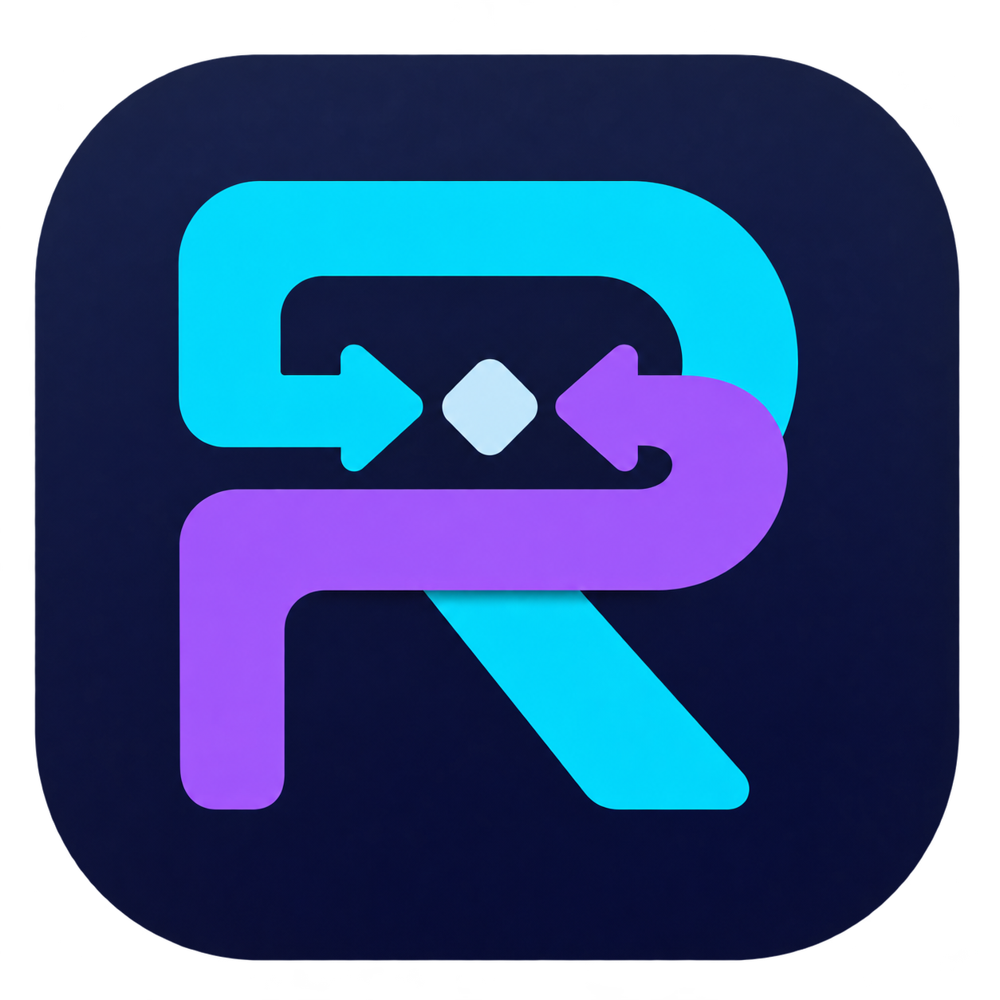

<p align="center">
  
</p>

<h1 align="center">Proxiverse</h1>

<p align="center">
  A native macOS HTTP &amp; HTTPS debugger.<br />
  Inspect traffic, mock responses, and pause requests in a SwiftUI and AppKit workspace.
</p>

<p align="center">
  <strong>Beta</strong> · macOS 14+ · Apple Silicon · MIT
</p>

<p align="center">
  <a href="https://github.com/PoiNaPoi/Proxiverse/releases">Download</a> ·
  <a href="#quick-start">Quick start</a> ·
  <a href="docs/USAGE.md">คู่มือภาษาไทย</a> ·
  <a href="https://github.com/PoiNaPoi/Proxiverse/issues">Report an issue</a>
</p>

Proxiverse helps you inspect and debug HTTP APIs on your Mac, simulators, emulators,
and connected test devices. It combines a native interface with a bundled
mitmproxy engine, so app users do not need to install Python separately.

## Features

| | What you can do |
| --- | --- |
| **Traffic inspection** | Inspect request and response headers, status, timing, and text body previews. Read JSON with syntax highlighting, formatting, and folding. |
| **Selective HTTPS decryption** | Enable decryption for individual hostnames and leave other HTTPS connections encrypted. |
| **Map Local** | Replace responses with text, JSON, or local files. Set status, headers, and delay; create a rule from a captured response. |
| **Breakpoints** | Pause requests or responses, edit supported headers and bodies, then continue or cancel. |
| **Search and saved filters** | Filter by host, path, method, status, content type, or state. Save filters and pin requests or domains. |
| **Device setup** | Configure Mac capture and use certificate setup helpers for iOS Simulator, Android/ADB, and phones or tablets on your network. |
| **Rule sharing** | Import and export portable Map Local rules, including supported Proxyman Map Local exports with embedded responses. |
| **Workspace layout** | Arrange inspectors beside or below traffic, with light/dark appearance and saved layout preferences. |

## Download

Get the macOS arm64 ZIP from [GitHub Releases](https://github.com/PoiNaPoi/Proxiverse/releases),
extract it, and move **Proxiverse.app** to Applications. Check the release notes for
the build's validation results and known issues.

- **Requirements:** Apple Silicon Mac, macOS 14 or later. Intel builds are not provided.
- **Status:** Early beta. Session import/export and a WebSocket message inspector are not available yet.
- **Signing:** Current builds are ad-hoc signed and have not been notarized by Apple.
  macOS may block the first launch. Review the download's source before allowing it
  through macOS Privacy & Security settings.

The minimum deployment target is macOS 14; testing on that version and first launch
on a second Mac remain unverified.

## Quick start

### Capture from your Mac

1. Open Proxiverse. The app starts a capture automatically on first launch.
   Fresh settings use a local-only proxy at `127.0.0.1:9090`.
2. Enable **Capture Mac Traffic** in the sidebar and approve the macOS permission
   request. This routes traffic from apps that use the selected network service's
   system proxy.
3. For HTTPS, use **Install Certificate** to open the setup helper and install and
   trust the capture CA on the client. Enable the host you want to inspect through
   **HTTPS** or **Enable Decryption**, then reconnect the client.
4. Select a request to inspect its headers and body. Right-click it to create a
   **Map Local** or breakpoint rule.
5. Click **Stop** when finished. Proxiverse attempts to restore the Mac proxy
   settings it changed.

HTTPS decryption is off by default. Trusting the CA and enabling a hostname are
separate steps; existing TLS connections must reconnect before changes take effect.

### Capture from a test device

1. Stop capture, open **Capture Settings**, enable **Allow test devices on local
   network**, and start capture again.
2. Connect the device to the same trusted network and set its HTTP proxy to the
   Mac's LAN IP and proxy port shown in the certificate setup helper.
3. Open **Install Certificate** and follow the instructions for your device.
   Enable HTTPS decryption for the host you are testing, then reconnect the client.

iPhone and iPad require full certificate trust after profile installation. Android
apps may need a debug Network Security Configuration that trusts user CAs. Automatic
Android CA installation requires root ADB; other devices use manual installation.
Certificate pinning must be handled in your own test app's debug configuration.

อ่าน [คู่มือใช้งานภาษาไทยแบบละเอียด](docs/USAGE.md) สำหรับขั้นตอนตั้งแต่เปิดแอป
ติดตั้ง CA และเชื่อมต่อ Mac/iPhone/Android/Simulator ไปจนถึงอ่าน API, กรอง traffic,
ใช้ Map Local/Breakpoint พร้อมแบบฝึกหัดและวิธีแก้ปัญหาที่พบบ่อย

## Privacy and local data

Capture processing runs locally on your Mac. Proxiverse does not implement a
developer-operated capture upload, account, analytics, or crash-reporting service.

Captured headers and body previews can contain credentials, cookies, and personal
data. They are **not automatically redacted or encrypted by Proxiverse**. Local
settings, rules, certificates, and capture data use
`~/Library/Application Support/Proxiverse/` by default.

Use Proxiverse only with systems and data you are authorized to test. Enable LAN
access only on a trusted test network. Restore device proxy settings and remove
installed test CAs when you no longer need them.

Read [Privacy and cleanup](docs/PRIVACY.md) and [Authorized use](docs/AUTHORIZED_USE.md)
before capturing sensitive traffic.

## Build from source

Use an Apple Silicon Mac with Xcode Command Line Tools and a Swift 5.9 or newer
toolchain. The build downloads a pinned mitmproxy engine and verifies its checksum
and code signature.

```sh
git clone https://github.com/PoiNaPoi/Proxiverse.git
cd Proxiverse
./scripts/build-app.sh
open dist/Proxiverse.app
```

The build script bundles the engine and generates app icons from
[`images/Proxiverse-icon.png`](images/Proxiverse-icon.png). It creates a local,
ad-hoc signed app.

Run the Swift tests:

```sh
./scripts/swift.sh test
```

The [usage and development guide](docs/USAGE.md) includes engine smoke tests and
benchmark commands. [Baseline measurements](docs/BASELINE.md) document their scope;
release notes record known test failures for each build.

GitHub security automation is configured in the [security checks guide](docs/SECURITY_CHECKS.md),
including CodeQL analysis for Swift/Python and Dependabot updates for Actions.

## Feedback and contributions

Bug reports and focused pull requests are welcome. For a bug report, include your
macOS version, Mac architecture, Proxiverse version, steps to reproduce, and the
expected and actual behavior. Use a minimal example with synthetic data.

Do not attach private captures, credentials, CA private keys, or personal data to
public issues. Check the [usage guide](docs/USAGE.md) and
[existing issues](https://github.com/PoiNaPoi/Proxiverse/issues) before opening a report.

## License and acknowledgments

Proxiverse-owned code and documentation are licensed under the [MIT License](LICENSE).
The app bundles [mitmproxy](https://github.com/mitmproxy/mitmproxy) and its dependencies,
which retain their respective licenses.

See [Third-party notices](THIRD_PARTY_NOTICES.md) for attribution and
[Engine source and replacement](docs/ENGINE_SOURCE.md) for the supplied source
archives and local rebuild instructions. Outstanding distribution and dependency
review items are recorded in [Public release review](docs/PUBLIC_RELEASE_REVIEW.md).
